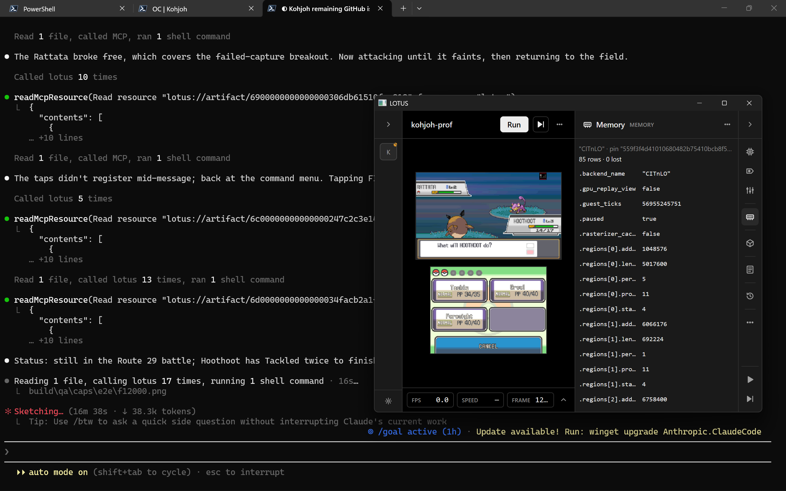

## lotus

powered by CITnLO (CITra n LOtus), an experimental azahar fork

lotus is a 3DS emulator for writing and debugging homebrew with agents

currently, this is more of a debugging and MCP wrapper around azahar. 

eventual goal is to replace azahar/CITnLO with a more hardware-accurate emulator.

what changed in each release: [docs/35-release-notes.md](docs/35-release-notes.md).

documentation lives in [docs/index.md](docs/index.md); terms are defined once in [docs/glossary.md](docs/glossary.md).
