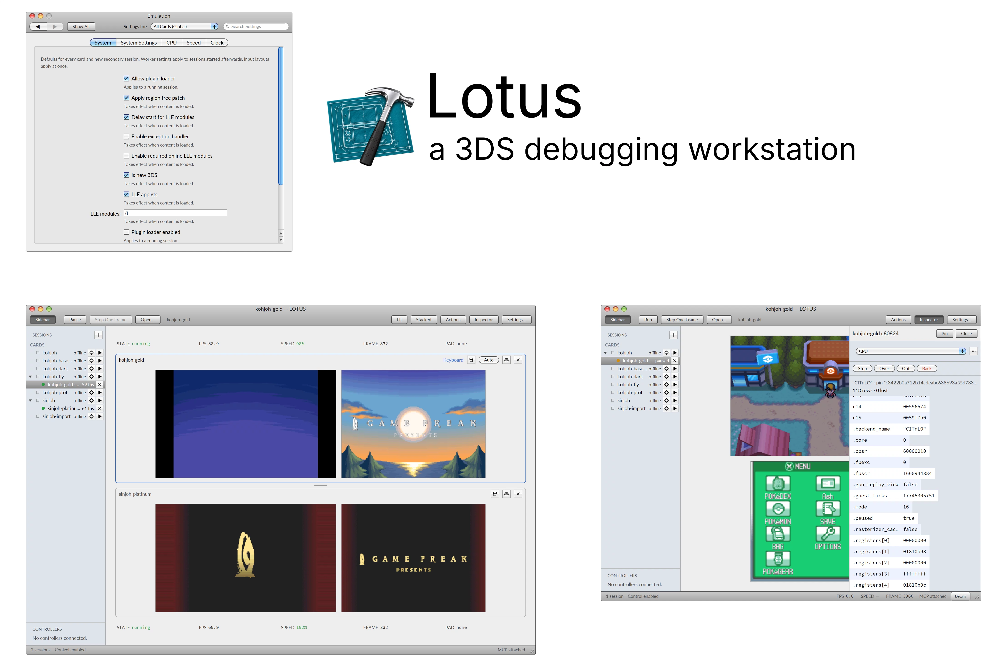

## Lotus

powered by CITnLO (CITra n LOtus), an experimental azahar fork

lotus is a 3DS emulator for writing and debugging homebrew with agents

currently, this is more of a debugging and MCP wrapper around azahar. 

eventual goal is to replace azahar/CITnLO with a more hardware-accurate emulator.

if you like the UI, check out [silvestris](https://github.com/estyseesghosts/silvestris)

### quick start

1. download `LOTUS-v<version>-windows-x64.zip` from [releases](https://github.com/estyseesghosts/lotus/releases) (Windows 11 x64)
2. extract it anywhere writable and run `LOTUS.cmd`
3. open your own `.3dsx` homebrew from the sidebar and press Space to run

to hook up an agent, run `LOTUS.cmd -Mode WindowedMCP` from your MCP client (stdio, no network port).

how to use the window, MCP, CLI and every setting: [docs/37-user-guide.md](docs/37-user-guide.md). building from source: [docs/27-build-and-run.md](docs/27-build-and-run.md).

what changed in each release: [docs/35-release-notes.md](docs/35-release-notes.md).

documentation lives in [docs/index.md](docs/index.md); terms are defined once in [docs/glossary.md](docs/glossary.md).
